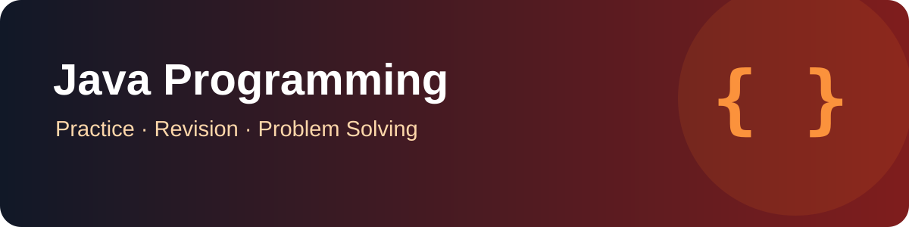

# Java Programming Practice

<p align="center"></p>

<p align="center"><strong>A home for Java fundamentals, OOP exercises and problem-solving practice.</strong></p>

## Concepts Used

No Java concepts are implemented in this repository yet because it currently contains no Java source files. The topics below are planned learning areas, not completed examples.

## Planned topics

- Java syntax, variables and data types
- Conditions, loops and methods
- Arrays and strings
- Classes, objects and constructors
- Object-oriented programming
- Collections and exception handling

## Current repository status

This repository currently contains its project overview and banner only; Java source files have not yet been added. Add each exercise as a clearly named `.java` file and include a short explanation and sample output.

## Suggested layout

```text
repo04/
├── assets/
│   └── java-practice-banner.svg
├── basics/
├── arrays/
├── strings/
├── oop/
└── README.md
```

## Run a future example

```bash
javac Example.java
java Example
```

## Maintainer

[Anurag Chaurasiya](https://github.com/anuragchaurasiya)